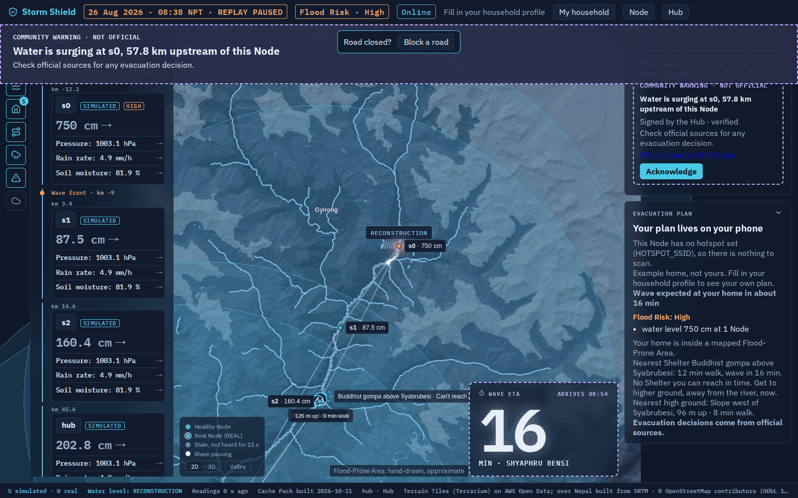
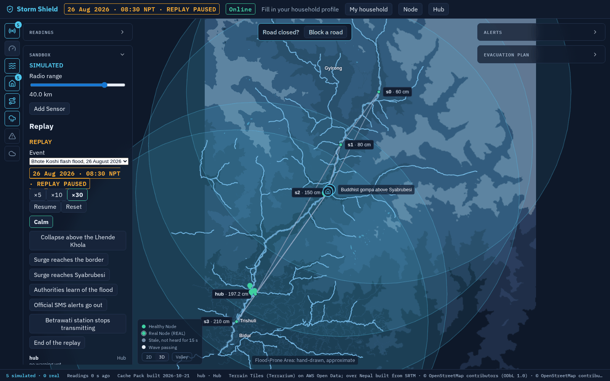
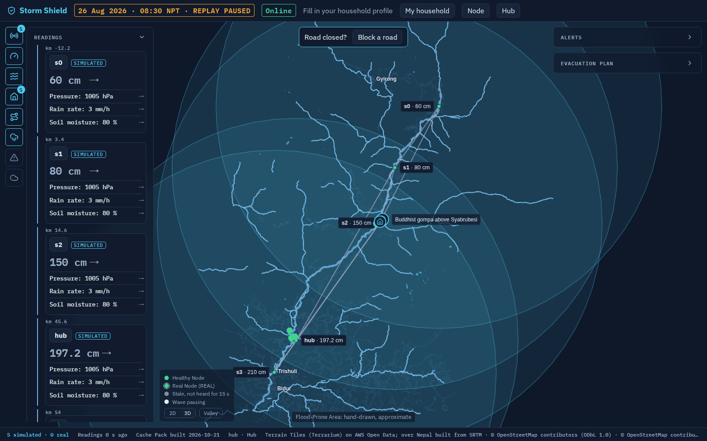
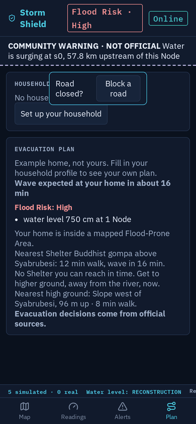
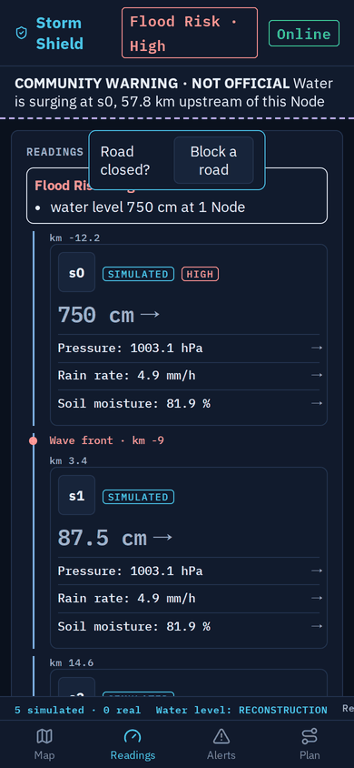
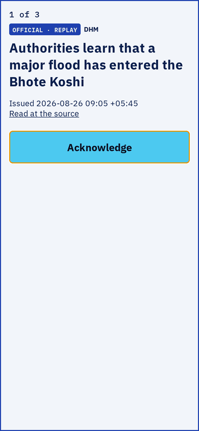

# Storm Shield

A local-first community sensor network: Nodes share readings over a local Mesh that keeps working when the internet goes down, and no outside service holds your data. Built at SwampHacks 2026 as a flood warning dashboard, demonstrated on a replay of the 26 August 2026 Bhote Koshi flood in Nepal; where it goes next is in `docs/roadmap.md`.



*The Nepal replay, eight minutes in: s0, 58 km upstream, sees the river jump to 750 cm. The Hub signs a Community Warning, Flood Risk goes High, the wave is 16 minutes from the example home, and the Evacuation Plan sends the household to high ground because the Shelter is out of reach in time. Everything in these screenshots is SIMULATED, and every Event is labelled REPLAY.*

## What it does

**The Mesh**
- Every Node (a laptop, a Raspberry Pi) runs the same FastAPI service and serves the dashboard to phones nearby. Nodes find each other over [Reticulum](https://reticulum.network/) on local Wi-Fi, loopback or fixed TCP addresses (Tailscale), with no internet and no server.
- Readings are signed. The Hub keeps a Node registry: a new Node signs up, the Hub operator accepts it, and only Registered Nodes count towards Flood Risk. Unverified Nodes are shown but never counted.
- Each Node shows whether it is Online or Mesh-only. When the internet drops, everything carried over the Mesh keeps working: readings, warnings, Shelter status, the evacuation plan.

**Flood warning (the first Rule set)**
- **Community Readings** are lists of Measurements (water level, rain rate, soil moisture, pressure, and any other kind a Sensor reports).
- **Flood Risk** is shown with its reasons ("water level 750 cm at 1 Node"), and nothing at all is shown on a calm day. Thresholds come from the Region's file.
- **Community Warnings**: a Surge upstream (300 cm in 60 s in Nepal) makes the Hub sign a warning that reaches every Node, with a full-screen takeover, a chime and a pager on phones. The Hub can also email the team. Warnings always say *NOT OFFICIAL* and point to the official source.
- **Official Alerts** (DHM in the Nepal replay) arrive when a Node is online and are kept separate from community ones.
- **Wave ETA**: the measured wave speed counts down to the household's home ("16 min · Shyaphru Bensi").

**For the household**
- A **Household Profile** (home, housing type, special-needs or pet-friendly Shelter) stays on the phone and never goes onto the Mesh.
- The **Evacuation Plan** picks the nearest open Shelter that can be reached in time on the road graph, or the nearest high ground when none can. It reroutes around roads people mark closed and uses the Shelter status the Hub announces.

**The map**
- A MapLibre map with 2D and 3D terrain, drawn from an offline **Cache Pack** (vector basemap, terrain, roads, Shelters, Flood-Prone Areas, high ground and replay weather). The pack is downloaded once, so the map still works with the internet gone.
- Layers for Nodes, the river, the wave front, rising water, and weather (rain, cloud, temperature) from the replay or the Hub's live forecast.
- A phone layout with Map, Readings, Alerts and Plan tabs.

**The Sandbox**
- `scripts/sandbox.sh` starts a Hub and four registered simulated Sensors in one process on an in-memory Mesh and opens the dashboard: no ports, slots or Hub ids to manage.
- From the Sandbox Panel you set the radio range (range circles and links on the map, messages hop from Node to Node), add, drag and remove Sensors, and pick an Event to play, pause, speed up or jump to a phase.
- Each Sensor reads the Event's water surface at its own position, so moving one up the slope keeps it dry.

**Regions**
- A Region is one hand-written file, `regions/<name>/region.json`, holding its area, time zone, units, alert sources, thresholds, Shelters, high ground and sensor sites. `scripts/build-cache-pack.sh <name>` builds its Cache Pack, published as a GitHub Release. Nepal is built and published. Fort Myers (Hurricane Ian's storm surge) is next; its source data is in `regions/fort-myers/sources/`.

## Screenshots

| Sandbox: radio range, Sensors and Replay controls | Calm day: readings along the river |
|---|---|
|  |  |

| Phone: Evacuation Plan | Phone: Readings | Phone: Official Alert |
|---|---|---|
|  |  |  |

## Try it

```bash
scripts/sandbox.sh            # needs uv and pnpm; the first run downloads the Cache Pack and builds the dashboard
```

It opens `http://localhost:8000`. Pick the Bhote Koshi Event in the Sandbox Panel and press Start, or jump straight to "Surge reaches the border".

## How it's built

| Part | Where | Stack |
|---|---|---|
| Node service (Mesh, rules, registry, Replay, Sandbox) | `node/` | Python 3.12+, FastAPI, Reticulum, uv, pytest |
| Dashboard (served by every Node) | `dashboard/` | React, Vite, TypeScript, MapLibre, pnpm, Vitest |
| Regions and their Events | `regions/` | `region.json` + `events/*.json` |
| Cache Pack builds, demo and dev scripts | `scripts/` | Python, bash |
| Raspberry Pi install and hotspot | `pi/` | bash |
| Specs, ADRs, glossary | `docs/`, `CONTEXT.md` | Markdown |

`scripts/check.sh` runs every typecheck, lint and test, and CI runs it on each pull request. The real-Reticulum tests run on demand (`uv run pytest -m mesh_integration`, or the "Mesh integration" workflow). The hackathon submission is tagged `v0-swamphacks`.

## Teammate setup (2 minutes)

```bash
git clone git@github.com:StormShields/Stormshield.git
cd Stormshield
git config core.hooksPath .githooks   # turns on secret scan + attribution strip (Claude Code does this for you)
cp .env.example .env                  # then fill in keys; .env never gets committed
```

Install the GitHub CLI and run `gh auth login` once; the agent skills use it for issues and pull requests. Then open the repo in your agent of choice. Read `AGENTS.md` once: it covers the workflow, code rules and how issues and pull requests work.

## How we work

- `AGENTS.md`: the rules for agents and humans, and every command
- `docs/roadmap.md`: what comes next and in which order
- [GitHub Issues](../../issues): the work, one issue per pull request (`docs/agents/issue-tracker.md`)
- `docs/specs/`: what we're building; `docs/adr/`: why
- `CONTEXT.md`: the glossary (Node, Hub, Mesh, Surge, Region, Event…)
- `docs/tickets/`: the hackathon tickets (frozen archive)
- `.claude/skills/`: playbooks (grill, spec, tickets, implement, review…), readable by any agent

Skills in `.claude/skills/` are adapted from [mattpocock/skills](https://github.com/mattpocock/skills) (MIT, see `.claude/skills/LICENSE-mattpocock-skills`).

## Run the hackathon demo

`scripts/run-demo.sh` starts the Cache Pack server, the Hub and Sensors S0 to S3 on this laptop and prints the dashboard addresses for the projector and the phones; Ctrl-C stops everything. Setup notes (hotspot, projector, the two phones' Household Profiles) are in `scripts/demo-setup.md`.

A volunteer's laptop joins the same Mesh with `scripts/join-demo.sh <hub address> <town>`, or the Docker image on Windows; the runbook is `scripts/join-demo.md`.
